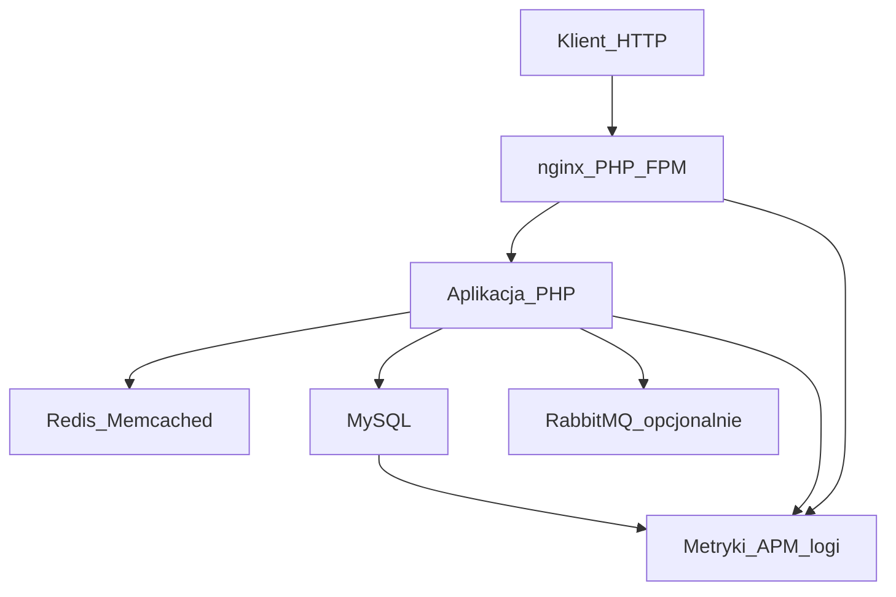

# Playbook testowania wydajności PHP

Praktyczny przewodnik: jak mierzyć, obciążać i diagnozować wydajność aplikacji PHP.

## Cel i metodyka

Decyzje wydajnościowe opieraj na danych, nie na intuicji:

```
hipoteza → pomiar (baseline) → zmiana → pomiar (weryfikacja) → decyzja
```

1. **Hipoteza** — np. „p95 checkoutu rośnie przez brak indeksu na `orders.user_id`”.
2. **Baseline** — zmierz obecny stan (latency, RPS, CPU, slow queries) w kontrolowanych warunkach.
3. **Zmiana** — jedna zmienna naraz (indeks, cache, limity FPM, kod).
4. **Weryfikacja** — ten sam scenariusz testu, te same progi; porównaj przed/po.
5. **Decyzja** — merge / rollback / kolejna hipoteza.

Zawsze zapisuj: URL/scenariusz, wersję kodu, środowisko, datę, wyniki i progi SLO.

## Co potrzebujesz

| Warstwa | Narzędzia |
|---------|-----------|
| Load / HTTP | `k6`, `wrk` (alternatywy: JMeter, Gatling) |
| Aplikacja PHP | PHP 8.x, profilowanie: Xdebug (dev), Tideways / Blackfire / php-spx |
| Baza | MySQL client, `EXPLAIN` / `EXPLAIN ANALYZE`, slow query log |
| Cache | Redis / Memcached CLI, hit ratio |
| System | `pidstat`, `iostat`, `vmstat`, `ss`, opcjonalnie `perf` |
| Observability | APM (Datadog, New Relic, Elastic APM), tracing, continuous profiling |

Szczegóły instalacji: [`scripts/REQUIREMENTS.md`](scripts/REQUIREMENTS.md).

**Zasada bezpieczeństwa:** testy obciążeniowe tylko na staging / dedykowanym środowisku. Nigdy nie celuj skryptów w produkcję bez zgody i capacity plan.

## Warstwy pomiaru



| Warstwa | Co mierzyć | Typowe narzędzia |
|---------|------------|------------------|
| HTTP | latency (p50/p95/p99), RPS, error rate | k6, wrk |
| PHP | czas requestu, CPU w workerze, alokacje | profiler, APM, `php-fpm` status |
| SQL | czas zapytań, rows examined, locks | EXPLAIN, slow log, APM DB spans |
| Cache | hit/miss, latency | Redis `INFO`, APM |
| System | CPU, I/O wait, memory, network | `sys-snapshot.sh`, pidstat |

Wolny endpoint bez profilu = zgadywanie. Najpierw znajdź warstwę (PHP vs SQL vs I/O), potem optymalizuj.

## Rodzaje testów

| Typ | Cel | Kiedy |
|-----|-----|-------|
| **Smoke** | czy endpoint w ogóle działa pod lekkim ruchem | przed każdym loadem, w CI |
| **Load** | zachowanie przy oczekiwanym ruchu | staging, przed release |
| **Stress** | gdzie jest limit (breaking point) | capacity planning |
| **Spike** | nagły skok ruchu | e-commerce / sezon |
| **Soak (endurance)** | wycieki pamięci, degradacja w czasie | przed peak season |

W tym repo:

- smoke → `scripts/k6/smoke.js`
- load → `scripts/k6/load.js`
- szybki throughput → `scripts/wrk/run-wrk.sh`
- pełna sesja (snapshot + load) → `scripts/run-load-suite.sh`

## Jak uruchamiać — kolejność

### 1. Profil lokalny (jeden request)

Znajdź hot path w kodzie PHP (profiler / APM / `benchmark-endpoint.php` jako szkic pomiaru czasu).

```bash
# przykład: lokalny pomiar pętli / logiki (bez pełnego stacku HTTP)
php scripts/php/benchmark-endpoint.php
```

### 2. SQL

Dla podejrzanych zapytań:

```bash
mysql -u USER -p DB < scripts/mysql/explain-slow.sql
```

Szukaj: `type=ALL`, duże `rows`, brak użycia indeksu, filesort / temporary.

### 3. Baseline systemowy + load na staging

```bash
export TARGET_URL="https://staging.example.com/api/health"
./scripts/run-load-suite.sh
```

Albo osobno:

```bash
./scripts/linux/sys-snapshot.sh before
k6 run -e TARGET_URL="$TARGET_URL" scripts/k6/load.js
./scripts/linux/sys-snapshot.sh after
```

Szybki test wrk:

```bash
export TARGET_URL="https://staging.example.com/api/health"
./scripts/wrk/run-wrk.sh
```

### 4. Porównanie z progami (SLO)

Przykładowe progi: [`config/thresholds.example.json`](config/thresholds.example.json).

W k6 thresholds są w skryptach (`http_req_duration`, `http_req_failed`). Fail w CI = regresja wydajności.

### 5. Observability podczas testu

Równolegle oglądaj:

- APM: p95 endpointu, top slow spans, DB time
- PHP-FPM: `listen queue`, active processes
- MySQL: threads running, InnoDB row lock waits
- Redis: `instantaneous_ops_per_sec`, evicted keys

## Skrypty w repozytorium

| Plik | Opis |
|------|------|
| [`scripts/k6/smoke.js`](scripts/k6/smoke.js) | lekki smoke (status, p95) |
| [`scripts/k6/load.js`](scripts/k6/load.js) | load z ramp-up i thresholds |
| [`scripts/wrk/run-wrk.sh`](scripts/wrk/run-wrk.sh) | throughput / latency przez wrk |
| [`scripts/php/benchmark-endpoint.php`](scripts/php/benchmark-endpoint.php) | lokalny pomiar czasu |
| [`scripts/mysql/explain-slow.sql`](scripts/mysql/explain-slow.sql) | szablon EXPLAIN |
| [`scripts/linux/sys-snapshot.sh`](scripts/linux/sys-snapshot.sh) | snapshot CPU/mem/IO/sieci |
| [`scripts/run-load-suite.sh`](scripts/run-load-suite.sh) | orchestracja: snapshot → k6 → snapshot |

Wszystkie testy HTTP biorą URL ze zmiennej **`TARGET_URL`** (bez hardcodu produkcji).

## Checklisty diagnozy

### Wolny endpoint (HTTP OK, ale p95 wysokie)

- [ ] APM / profiler: czy czas jest w PHP, SQL, HTTP outbound, czy cache?
- [ ] Liczba zapytań N+1?
- [ ] Serializacja / duże payloady JSON?
- [ ] Cold cache vs warm cache — czy wynik się różni?

### High CPU (PHP-FPM / PHP)

- [ ] Profiler: hot functions, regex, JSON encode/decode, crypto
- [ ] Czy OPcache włączony na staging/prod?
- [ ] Czy Xdebug wyłączony poza lokalnym debugiem?

### Wolne SQL

- [ ] `EXPLAIN` / `EXPLAIN ANALYZE`
- [ ] Indeksy zgodne z `WHERE` / `JOIN` / `ORDER BY`
- [ ] Selectivity, covering index, unikaj `SELECT *`
- [ ] Lock waits / long transactions

### Cache miss / brak zysku z cache

- [ ] Klucze i TTL — czy nie invalidujesz zbyt agresywnie?
- [ ] Stampede (thundering herd) przy wygaśnięciu?
- [ ] Latencja Redis vs koszt przeliczenia

### Limity PHP-FPM / nginx

- [ ] `pm.max_children` vs RAM
- [ ] `listen.queue` / 502 pod loadem
- [ ] Timeouty upstream vs timeouty k6
- [ ] Keepalive, buffer sizes (nginx)

## Regresja w CI (szkic)

1. Smoke na każdym PR (`k6 run scripts/k6/smoke.js`) przeciw staging preview.
2. Load nocny / przed release z thresholds z `config/thresholds.example.json`.
3. Artefakty: JSON summary k6 + snapshot systemowy + link do APM trace z okna testu.

## Słownik metryk

| Metryka | Znaczenie |
|---------|-----------|
| **RPS** | requestów na sekundę |
| **p95 / p99** | 95%/99% requestów szybsze niż ta wartość |
| **error rate** | odsetek odpowiedzi 4xx/5xx lub failed checks |
| **SLO** | ustalony cel (np. p95 < 300 ms dla checkout) |
| **baseline** | pomiar odniesienia przed zmianą |

## Poza zakresem tego repo

- Pełna aplikacja e-commerce w Dockerze
- Gotowa integracja z Datadog/New Relic (podłącz agent + porównuj te same scenariusze k6)
- Skrypty JMeter/Gatling — koncepcyjnie tożsame z k6 (scenariusz → VU → thresholds)
# _php_performance
